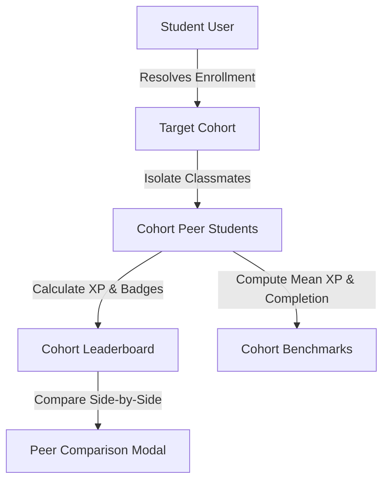
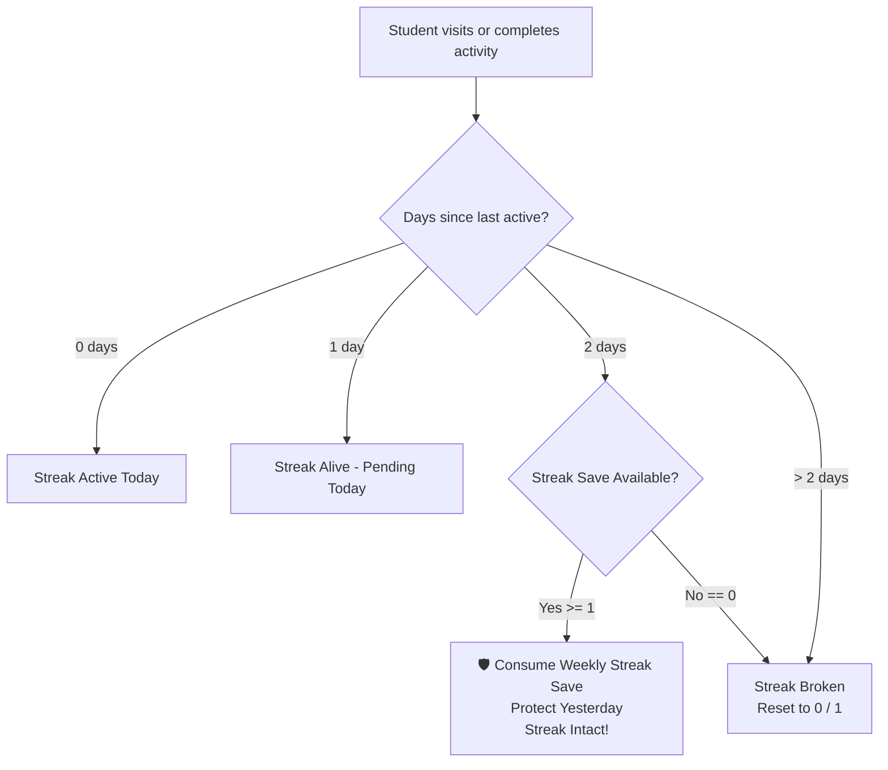

# Fortivex LMS — Achievements, Cohort Standings & Learning Streaks Documentation

**Document Status**: Official Architecture & Implementation Guide  
**Version**: 1.0  
**Updated**: October 2026  
**Scope**: Student Gamification, Cohort Isolation, Learning Streaks & Weekly Streak Save Mechanics  

---

## 1. Executive Overview

The **Achievements & Gamification System** in Fortivex LMS is built to drive consistent student engagement, foster healthy peer camaraderie, and reward sustained curriculum mastery. 

The system is governed by two fundamental architectural principles:
1. **Strict Cohort-Wise Isolation**: A student's rank, leaderboard standings, benchmark averages, and milestone comparisons are calculated and visible **strictly within their enrolled cohort**. Students never compete against learners in differing cohorts or external academic organizations.
2. **Learning Streaks with Weekly Streak Saves**: Students cultivate daily learning habits through consecutive-day study streaks. To prevent discouragement from single unavoidable absences, every student receives **1 streak save per week** that automatically protects their active streak if they miss a single day.

---

## 2. Cohort-Wise Isolation Architecture

### 2.1 Multi-Tenant Cohort Boundaries
In Fortivex LMS, students are enrolled in cohorts through the `Enrollment` model linking `student_id`, `cohort_id`, `program_id`, and `organization_id`. 

When requesting achievement metrics:
- The system queries only active enrollments belonging to the student.
- If a student is enrolled in multiple cohorts (e.g., dual programs), an interactive **Cohort Switcher** allows the student to toggle between cohorts.
- Leaderboard items, peer rankings, and cohort benchmarks are aggregated exclusively from other students enrolled in the same `cohort_id`.



### 2.2 Security & Data Protection
Cross-cohort data access is strictly prevented:
- `GET /api/v1/progress/cohort-achievements/compare/{peer_student_id}?cohort_id={cohort_id}` validates that **both** the authenticated student and the target peer possess active enrollments in the specified `cohort_id`.
- If an unauthorized lookup is attempted, the API rejects the request with `HTTP 403 Forbidden` or `HTTP 404 Not Found`.

---

## 3. Dynamic XP & Gamification Engine

### 3.1 XP Calculation Formula
XP is calculated dynamically from learning milestones rather than stored statically, eliminating state drift:

$$\text{Total XP} = (\text{Activities Completed} \times 50) + (\text{Cumulative Quiz Score} \times 20) + \sum (\text{Badge Rewards})$$

- **Activities Completed**: 50 XP per completed curriculum activity (video, text, lab, or reading).
- **Quiz Performance**: 20 XP per scored quiz question passed across attempts.
- **Milestone Badges**: Tiered XP rewards ranging from 50 XP (Bronze) to 1,200 XP (Platinum).

### 3.2 Ranking & Tie-Breaking
Cohort ranking is derived deterministically using a multi-factor sort:
1. Primary: `total_xp` (Descending)
2. Secondary: `activities_completed` (Descending)
3. Tertiary: `quiz_average` (Descending)
4. Quaternary: Earliest activity completion timestamp

---

## 4. Daily Learning Streaks & Weekly Streak Save Mechanics

### 4.1 Daily Activity Criteria
A calendar day (UTC) is designated as **active** if the student registers any of the following:
1. Marked any curriculum `ActivityCompletion`
2. Completed and submitted a `QuizAttempt`
3. Interacted with the AI Chatbot (`ChatbotDailyUsage`)
4. Submitted a daily study heartbeat check-in via `POST /api/v1/progress/streak/heartbeat`

### 4.2 The "1 Streak Save Per Week" Rule
Students receive **1 Streak Save** (streak freeze) per week:
- **Weekly Replenishment**: Every Monday (or 7 days from last replenishment), if the student's available saves are $< 1$, `streak_freeze_count` resets back to `1`.
- **Max Capacity**: 1 save. Unused saves do not stack beyond 1, ensuring consistent active engagement.
- **Automatic Protection**: If a student studies on Day $D$, misses Day $D+1$, and returns on Day $D+2$:
  - If `streak_freeze_count >= 1`:
    - 1 save is automatically consumed (`streak_freeze_count = 0`, `total_freezes_used += 1`).
    - Day $D+1$ is marked as `SAVED` (🛡️) in the audit log `StudentStreakFreezeLog`.
    - The streak continuity is preserved and continues uninterrupted.
  - If `streak_freeze_count == 0`:
    - The streak breaks and resets to `0` (or `1` upon completing Day $D+2$'s activity).
- **Manual Protection**: Students can also trigger `POST /api/v1/progress/streak/use-save` to proactively apply their weekly save to yesterday's missed day.



### 4.3 7-Day Timeline Visualization
Students see an interactive 7-day timeline:
- **🔥 Completed / Active**: Student completed qualifying learning activity.
- **🛡️ Saved with Freeze**: Protected by the weekly streak save.
- **⏳ Today Pending**: Consecutive streak is burning; study today to log activity.
- **⚪ Rest / Missed**: Missed without an available streak save.

---

## 5. Milestone Badges Catalog

The badge system evaluates student achievements across four core domains:

| Badge ID | Title | Domain | Tier | Target | XP | Description |
| :--- | :--- | :--- | :--- | :--- | :--- | :--- |
| `FIRST_STEP` | First Steps | Curriculum | Bronze | 1 Activity | +50 | Completed first activity in cohort |
| `KNOWLEDGE_SEEKER` | Knowledge Seeker | Curriculum | Bronze | 5 Activities | +150 | Completed 5 activities |
| `DILIGENT_SCHOLAR` | Diligent Scholar | Curriculum | Silver | 10 Activities | +300 | Completed 10 activities |
| `CURRICULUM_COMPLETER` | Syllabus Finisher | Curriculum | Platinum | 100% | +1,000 | Finished all cohort activities |
| `FIRST_QUIZ` | Knowledge Verified | Assessment | Bronze | 1 Quiz | +75 | Passed first cohort quiz |
| `PERFECT_SCORE` | Flawless Score | Assessment | Silver | 100% Score | +200 | Achieved 100% on a quiz |
| `HIGH_ACHIEVER` | Academic Excellence | Assessment | Gold | $\ge 85\%$ Avg | +450 | Maintained $\ge 85\%$ quiz average |
| `QUIZ_VETERAN` | Quiz Veteran | Assessment | Silver | 3 Quizzes | +250 | Completed 3 quizzes |
| `TOP_CONTENDER` | Top Contender | Standing | Bronze | Top 50% | +200 | Ranked in upper half of cohort |
| `PODIUM_FINISHER` | Podium Finisher | Standing | Silver | Top 3 | +400 | Reached Top 3 in cohort standings |
| `COHORT_VALEDICTORIAN` | Cohort Champion | Standing | Platinum | #1 Rank | +750 | Ranked #1 highest in cohort |
| `STREAK_3_DAYS` | Ignition Flame | Streak | Bronze | 3 Days | +100 | Maintained 3-day learning streak |
| `STREAK_7_DAYS` | Week Warrior | Streak | Silver | 7 Days | +300 | Maintained 7-day study streak |
| `STREAK_14_DAYS` | Fortnight Phenom | Streak | Gold | 14 Days | +600 | Maintained 14-day study streak |
| `STREAK_30_DAYS` | Unstoppable Force | Streak | Platinum | 30 Days | +1,200 | Epic 30-day learning streak |
| `STREAK_SAVER` | Guardian Angel | Streak | Bronze | 1 Save | +150 | Successfully used weekly streak save |

---

## 6. Database Schema & Migration

### 6.1 `student_streaks` Table
```sql
CREATE TABLE student_streaks (
    id SERIAL PRIMARY KEY,
    student_id INTEGER NOT NULL REFERENCES students(id) ON DELETE CASCADE,
    current_streak INTEGER NOT NULL DEFAULT 0,
    longest_streak INTEGER NOT NULL DEFAULT 0,
    last_activity_date DATE NULL,
    streak_freeze_count INTEGER NOT NULL DEFAULT 1,
    last_freeze_replenished_at TIMESTAMP WITH TIME ZONE NULL,
    total_freezes_used INTEGER NOT NULL DEFAULT 0,
    last_freeze_used_date DATE NULL,
    created_at TIMESTAMP WITH TIME ZONE NOT NULL DEFAULT now(),
    updated_at TIMESTAMP WITH TIME ZONE NOT NULL DEFAULT now(),
    CONSTRAINT uq_student_streaks_student_id UNIQUE (student_id)
);
CREATE UNIQUE INDEX ix_student_streaks_student_id ON student_streaks (student_id);
```

### 6.2 `student_streak_freeze_logs` Table
```sql
CREATE TABLE student_streak_freeze_logs (
    id SERIAL PRIMARY KEY,
    streak_id INTEGER NOT NULL REFERENCES student_streaks(id) ON DELETE CASCADE,
    student_id INTEGER NOT NULL REFERENCES students(id) ON DELETE CASCADE,
    saved_date DATE NOT NULL,
    reason VARCHAR(50) NOT NULL DEFAULT 'WEEKLY_AUTO_PROTECTION',
    created_at TIMESTAMP WITH TIME ZONE NOT NULL DEFAULT now(),
    updated_at TIMESTAMP WITH TIME ZONE NOT NULL DEFAULT now()
);
CREATE INDEX ix_student_streak_freeze_logs_streak_id ON student_streak_freeze_logs (streak_id);
CREATE INDEX ix_student_streak_freeze_logs_student_id ON student_streak_freeze_logs (student_id);
```

### 6.3 Alembic Revision
- **Migration ID**: `e00d8cbc7f29_add_student_streak_models.py`
- **Revises**: `b6b4e573657c`
- **Head**: Current database head revision.

---

## 7. REST API Reference

### 7.1 `GET /api/v1/progress/cohort-achievements`
Returns complete cohort achievements, ranking, benchmarks, milestone badges, and streak status.
- **Query Params**: `cohort_id` (optional; defaults to student's primary active cohort)
- **Sample Response**:
```json
{
  "has_cohort": true,
  "active_cohort": {
    "cohort_id": 1,
    "cohort_name": "AIML Full Stack Development — Jan 2026 Cohort",
    "cohort_code": "2026-JAN"
  },
  "current_student_stats": {
    "student_id": 1,
    "full_name": "Empowers Academy Sample Student",
    "rank": 1,
    "total_xp": 2815,
    "activities_completed": 7,
    "total_activities": 13,
    "completion_rate": 54,
    "quiz_average": 42.4,
    "quizzes_attempted": 2,
    "badges_unlocked": 8,
    "total_possible_badges": 16,
    "current_streak": 3,
    "longest_streak": 3,
    "streak_freeze_count": 1
  },
  "streak": {
    "current_streak": 3,
    "longest_streak": 3,
    "last_activity_date": "2026-10-13",
    "is_active_today": true,
    "streak_freeze_count": 1,
    "streak_freeze_replenishes_in_days": 6,
    "streak_freeze_used_this_week": false,
    "total_freezes_used": 0,
    "last_freeze_used_date": null,
    "streak_saved_recently": false,
    "alert_message": "🔥 Flame is blazing! You've logged activity today (3-day streak).",
    "history": [
      { "date": "2026-10-07", "day_name": "Wed", "status": "ACTIVE" },
      { "date": "2026-10-08", "day_name": "Thu", "status": "ACTIVE" },
      { "date": "2026-10-09", "day_name": "Fri", "status": "MISSED" },
      { "date": "2026-10-10", "day_name": "Sat", "status": "MISSED" },
      { "date": "2026-10-11", "day_name": "Sun", "status": "ACTIVE" },
      { "date": "2026-10-12", "day_name": "Mon", "status": "ACTIVE" },
      { "date": "2026-10-13", "day_name": "Tue", "status": "TODAY_COMPLETED" }
    ]
  },
  "leaderboard": [
    {
      "rank": 1,
      "student_id": 1,
      "name": "Empowers Academy Sample Student",
      "is_current_student": true,
      "total_xp": 2815,
      "current_streak": 3,
      "activities_completed": 7,
      "total_activities": 13,
      "quiz_average": 42.4,
      "badges_count": 8
    }
  ]
}
```

### 7.2 `GET /api/v1/progress/cohort-achievements/compare/{peer_student_id}`
Returns side-by-side comparison between the current student and a cohort peer.

### 7.3 `GET /api/v1/progress/streak`
Returns current student's daily streak, freeze availability, and 7-day timeline.

### 7.4 `POST /api/v1/progress/streak/heartbeat`
Logs study check-in for today, advancing the consecutive streak.

### 7.5 `POST /api/v1/progress/streak/use-save`
Applies an available weekly streak save to protect/repair yesterday's missed day.

---

## 8. Frontend Component & Page Guide

The user interface is hosted at [`/student/achievements`](file:///d:/Krishna%20Stuff/Work/Fortivex%20AI/Fortivex_LMS/frontend/src/app/student/achievements/page.tsx) and built with responsive, accessible Vanilla CSS:

1. **Cohort Switcher & Hero Banner**:
   - Header with cohort badge and program context.
   - 5 Stat meters: Total XP, Study Streak, Curriculum Completion, Quiz Average, and Badges Unlocked.
2. **Streak & Freeze Showcase Widget**:
   - Big pulsating Flame icon (🔥) with active status indicator.
   - 7-Day Timeline displaying day status icons (🔥, 🛡️, ⏳, ⚪).
   - Streak Shield pill showing available weekly streak freeze status.
   - Quick action button for daily study check-in and manual streak save.
3. **Cohort Standings & Podium**:
   - Top-3 Olympic-style Podium (Champion, Silver, Bronze) with flame indicators.
   - Interactive table with real-time peer stats, XP, streaks, and "Compare with You" buttons.
4. **Milestone Badges Catalog**:
   - Category filtering pills: *All*, *Curriculum Progress*, *Quizzes & Mastery*, *Cohort Standing*, and *Streaks & Saves*.
   - Lock/unlock opacity, tier markers (Bronze, Silver, Gold, Platinum), and live progress bars.
5. **Side-by-Side Comparison Modal**:
   - Compares XP, completion rates, quiz averages, daily study streaks, and longest streaks between the student and any peer in the cohort.
