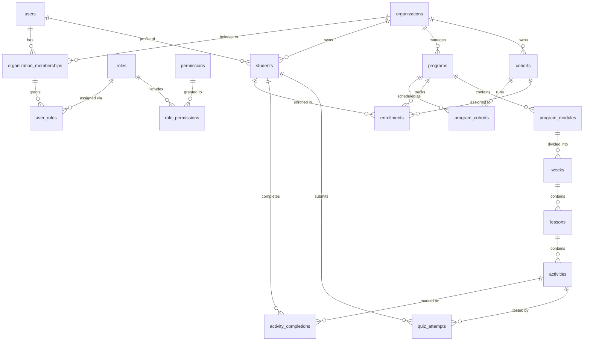
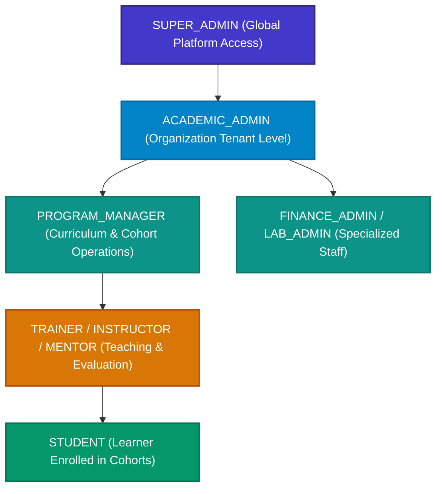
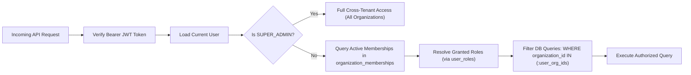

# Fortivex LMS — Database Permissions & Role Hierarchy

This document provides a clear, visual reference for how database permissions, multi-tenant scoping, roles, and entity relationships work across **Fortivex LMS**.

---

## 1. Core Architectural Principle

> **One LMS. Shared Database. Row-Level Organization Scoping.**

- Users belong to the central `users` table.
- Organizations (such as **Empowers Academy** and **Medivex AI**) are records in the `organizations` table.
- **Roles are not attached directly to users.** Instead, roles are attached to an `organization_membership`.
- This enables a single user account to hold different roles in different organizations (e.g. an *Instructor* at Empowers Academy, but a *Student* at Medivex AI) without duplicate accounts.

---

## 2. Entity-Relationship & Permission Architecture

The diagram below illustrates how authentication, memberships, roles, programs, cohorts, and curricula interconnect in the database:

---

## 3. Role Hierarchy Pyramid

Authority cascades from global platform operations down to cohort-level learners:

---

## 4. Multi-Tenant Scoping & Enforcement Flow

Every incoming backend request passes through the dependency guard in `app.api.deps`:

---

## 5. Permission & Capability Matrix

| Role | Scope | User & Member Management | Programs & Curriculum | Cohorts & Classes | Live Classes | Assessments & Grading | Student Progress |
| :--- | :--- | :--- | :--- | :--- | :--- | :--- | :--- |
| **`SUPER_ADMIN`** | **Global** (All Tenants) | Full create/read/update across all tenants | Full access across all orgs | Full access across all orgs | Host & monitor any session | Full access | Full system audit |
| **`ACADEMIC_ADMIN`** | **Tenant-scoped** (`organization_id`) | Create/manage users in tenant; grant tenant roles | Create, update, publish programs & modules | Create and schedule cohorts | Schedule & manage live rooms | View all grades & attempts | View tenant-wide analytics |
| **`PROGRAM_MANAGER`** | **Tenant-scoped** | View tenant users | Build modules, weeks, lessons, activities | View & assign cohorts | Schedule live sessions | Manage quizzes & question banks | View aggregate cohort progress |
| **`TRAINER` / `INSTRUCTOR`** | **Tenant / Assigned Cohorts** | View enrolled cohort students | Read programs; create/edit exercises & quizzes | View assigned cohorts & rosters | Host live classes & video rooms | Review submissions, evaluate code, view attempts | Monitor cohort completion |
| **`STUDENT`** | **Own Record** | Read and update own profile (`/users/me`) | Read enrolled course materials | View enrolled cohort details | Join scheduled live sessions | Take quizzes, submit code & assignments | Track own progress & completion |

---

## 6. Database Tables & Key Columns

### Identity & Access Control
- **`users`**: Central account credentials.
  - Columns: `id`, `email`, `hashed_password`, `full_name`, `phone_number`, `bio`, `title`, `avatar_url`, `is_active`, `created_at`, `updated_at`.
- **`organizations`**: Educational institutions (e.g. Empowers Academy, Medivex AI).
  - Columns: `id`, `name`, `slug`, `code`, `status`, `primary_domain`, `lms_domain`, `brand_config`.
- **`organization_memberships`**: Connects users to organizations.
  - Columns: `id`, `user_id` (FK), `organization_id` (FK), `status` (`ACTIVE`/`INACTIVE`).
- **`roles`**: System role catalog.
  - Columns: `id`, `name` (`SUPER_ADMIN`, `ACADEMIC_ADMIN`, `PROGRAM_MANAGER`, `TRAINER`, `MENTOR`, `STUDENT`), `description`.
- **`user_roles`**: Links a role to a specific organization membership.
  - Columns: `id`, `organization_membership_id` (FK), `role_id` (FK).
- **`permissions` & `role_permissions`**: Granular capability codes.
  - Columns: `permissions.code`, `role_permissions.role_id` (FK), `role_permissions.permission_id` (FK).

### Academic & Learning Hierarchy
- **`students`**: Learner profile within an organization.
  - Columns: `id`, `user_id` (FK), `organization_id` (FK), `student_code`, `lifecycle_status`.
- **`programs`**: High-level training tracks (e.g. AIML Full Stack Development, Clinical Research).
  - Columns: `id`, `organization_id` (FK), `name`, `code`, `description`, `status`.
- **`cohorts`**: Scheduled intakes / classes of a program.
  - Columns: `id`, `organization_id` (FK), `name`, `code`, `start_date`, `end_date`, `status`.
- **`program_cohorts`**: Many-to-many link between cohorts and programs.
  - Columns: `program_id` (FK), `cohort_id` (FK).
- **`enrollments`**: Connects a student to a program and cohort.
  - Columns: `id`, `student_id` (FK), `program_id` (FK), `cohort_id` (FK nullable), `organization_id` (FK), `status`.

### Curriculum Structure
- **`program_modules`**: Top-level course units (`program_id`, `title`, `order`).
- **`weeks`**: Weekly milestones (`program_module_id`, `week_number`, `title`, `order`).
- **`lessons`**: Topic lessons (`week_id`, `title`, `description`, `order`).
- **`activities`**: Learning exercises (`lesson_id`, `title`, `activity_type`, `content`, `order`).

### Student Progress & Assessments
- **`activity_completions`**: Completion tracking per activity (`student_id`, `activity_id`, `completed_at`).
- **`quiz_attempts`**: Graded quiz results (`student_id`, `activity_id`, `score`, `total_questions`, `answers_json`).

---

## 7. Relevant Code References

- **Backend User & Membership Models**: `backend/app/models/user.py`, `backend/app/models/organization.py`
- **RBAC & Join Tables**: `backend/app/models/role.py`, `backend/app/models/permission.py`
- **FastAPI Auth & Scope Dependencies**: `backend/app/api/deps.py`
- **Frontend Role Constants & Gateways**: `frontend/src/lib/auth/roles.ts`
- **Dev Seed Data**: `backend/scripts/seed_dev_data.py`

---

## 8. Seed / Pre-configured Accounts Reference

| Role | Email | Password | Organization(s) | Scope / Purpose |
| :--- | :--- | :--- | :--- | :--- |
| **SUPER_ADMIN** | `superadmin@fortivex.com` | `admin123` | **Empowers Academy** & **Medivex AI** | Cross-organization global manager. Can manage Academic Admins, organizations, and global settings across all tenants. |
| **ACADEMIC_ADMIN** | `admin@empowers.com` | `admin123` | **Empowers Academy** | Academic Admin managing programs, trainers, and students for Empowers Academy only. |
| **ACADEMIC_ADMIN** | `admin@medivex.com` | `admin123` | **Medivex AI** | Academic Admin managing clinical research programs and students for Medivex AI only. |
| **TRAINER** | `instructor@empowers.com` | `admin123` | **Empowers Academy** | Instructor delivering curriculum and grading cohorts in Empowers Academy. |
| **STUDENT** | `student@empowers.com` | `student123` | **Empowers Academy** | Enrolled learner in Empowers Academy. |
| **STUDENT** | `student@medivex.com` | `student123` | **Medivex AI** | Enrolled learner in Medivex AI. |

